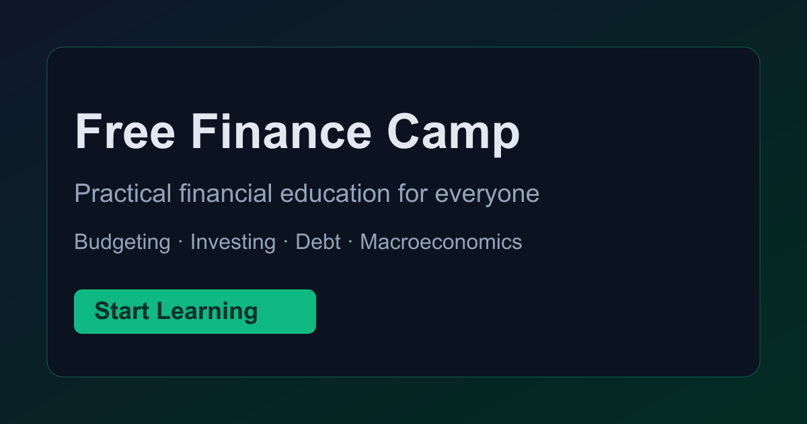

# Free Finance Camp 🏕️

A gamified, interactive web application designed to teach personal finance concepts for free. Think "Duolingo for Finance."



## Features

*   **Interactive Curriculum**: Financial literacy modules covering everything from Budgeting 101 to Crypto & Options.
*   **Gamified Learning**: Earn XP, level up, and unlock new content as you progress.
*   **Simulations**:
    *   **Market Timer Game**: Try to beat the market (and learn why you probably can't).
    *   **Compound Interest Calculator**: See how your money grows.
    *   **Car Buying Calculator**: Lease vs. Buy vs. Cash.
*   **Vocabulary Review**: Unlock flashcards for key financial terms (ETF, APR, Deductible, etc.) as you complete lessons.

## Getting Started

### Prerequisites
- Node.js installed.

### Installation

1.  Clone the repository:
    ```bash
    git clone https://github.com/Eric-Christine/Free_Finance_Camp.git
    ```
2.  Navigate to the directory:
    ```bash
    cd Free_Finance_Camp
    ```
3.  Install dependencies:
    ```bash
    npm install
    ```
4.  Run the development server:
    ```bash
    npm run dev
    ```

## iOS App (iPhone) - Shared Web + Mobile Stack

This project now includes Capacitor iOS support so you can ship an iPhone app while keeping one codebase.

- iOS project path: `ios/`
- Capacitor config: `capacitor.config.ts`
- iPhone app loads: `https://freefinancecamp.com`

### Why this keeps updates easy

- Content updates remain web-first (same React app + same data files).
- After you deploy web (`npm run deploy`), iPhone users automatically see updated content because the app uses the live site URL.
- No duplicate lesson content pipeline for iOS.

### Shared login + progress between web and iPhone

- Auth is handled by Supabase in `src/context/AuthContext.jsx`.
- Progress is stored in the shared `user_progress` table in Supabase (`src/context/ProgressContext.jsx`).
- A learner who signs in with the same account on web and iPhone will get the same progress, XP, and completed lessons.

### iOS commands

- Create iOS project (one-time): `npm run ios:add`
- Sync web assets/config/plugins to iOS: `npm run ios:sync`
- Open native project in Xcode: `npm run ios:open`

### Release flow for iPhone

1. Run `npm run ios:sync`.
2. Run `npm run ios:open`.
3. In Xcode, set your Apple Team + Bundle Identifier.
4. Archive and distribute to TestFlight/App Store.

### Notes

- Keep production Supabase env vars set so iOS uses real auth/progress sync (not mock auth).
- If you ever want fully bundled offline web assets instead of live URL loading, remove the `server.url` block in `capacitor.config.ts` and rerun `npm run ios:sync`.

### Lesson Content Export (Word Copy Helper)

- Run `npm run lessons:export` to generate `/Users/ericchristine/Desktop/code_projects/Free_Finance_Camp/lesson-content-export.md`.
- Run `npm run lessons:watch` to keep that file auto-updated whenever lesson data changes in:
  - `src/data/curriculum.js`
  - `src/data/quizzes.js`
- `npm run dev` and `npm run build` also regenerate this export automatically.

### Lesson XP (Leaderboard)

- Leaderboard XP is awarded server-side from the `public.lesson_xp_rewards` table, not from values the browser sends.
- After adding or re-pricing lessons, run `npm run xp:sql` (also part of `npm run build`) and paste `supabase/lesson_xp_rewards.sql` into the Supabase SQL editor. It is safe to re-run.
- Until that SQL is applied, completing a new lesson still works in the app but earns no leaderboard XP.

### Environment Variables

Copy `.env.example` to `.env` and fill in:

- Supabase keys (`VITE_SUPABASE_URL`, `VITE_SUPABASE_ANON_KEY`)
- Analytics uses the GA4 tag in `index.html`; no Firebase web config is required.

Analytics emits:
- `goal_completion` when a lesson is newly completed

## Curriculum Overview

The current module and lesson list is maintained in `src/data/curriculum.js` and shown on `/curriculum`.

## Tech Stack

-   React + Vite
-   Recharts (Data Visualization)
-   Lucide React (Icons)
-   Tailwind-inspired CSS Variables

## Public-page rendering

`npm run build` prerenders every sitemap URL with Playwright Chromium. Install the build browser with `npx playwright install chromium` first. Builds fail if a public page has a missing heading, duplicate headings, missing canonical metadata, or JavaScript errors. Firebase serves these static pages directly, preserves the app shell for known private routes, and returns `404.html` with an HTTP 404 for unknown paths.
